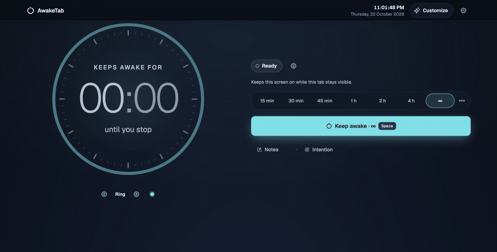
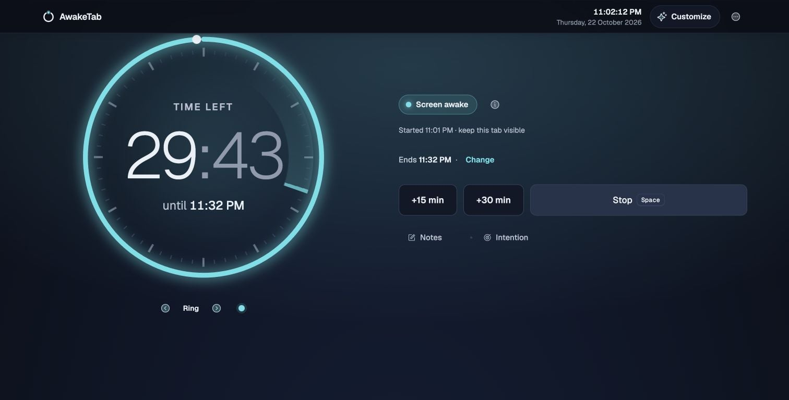
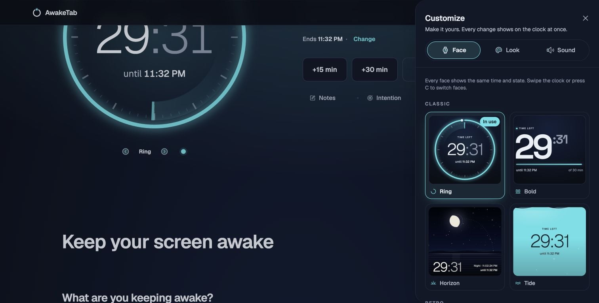
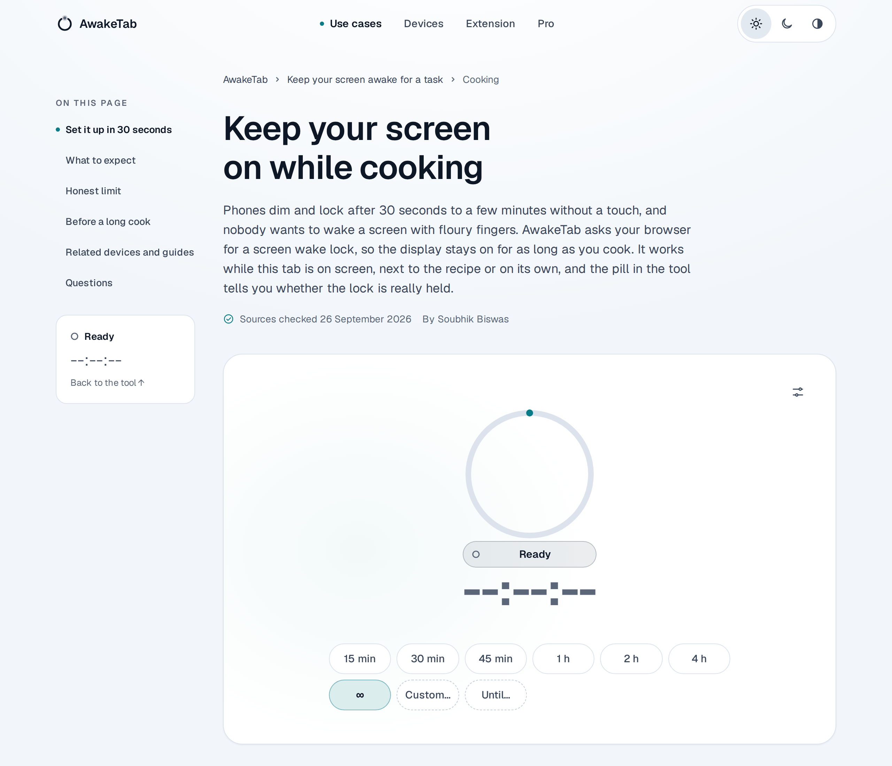
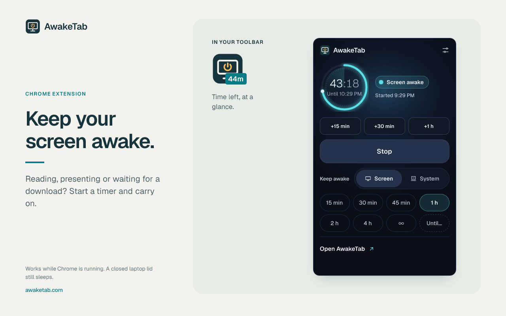
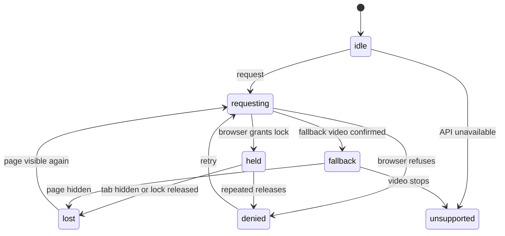
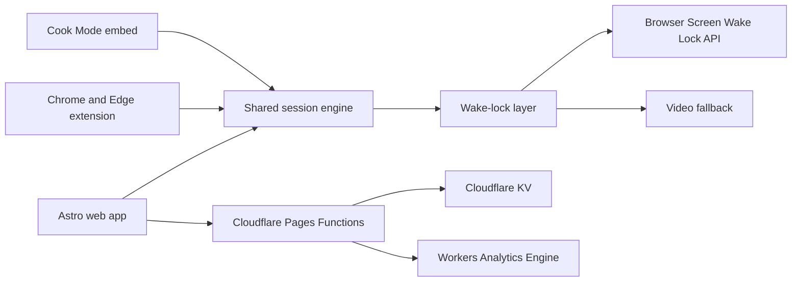

<div align="center">
  <picture>
    <source media="(prefers-color-scheme: dark)" srcset=".github/readme/hero-dark.svg">
    
  </picture>

  <p><strong>Keep your screen awake, and know when it really is.</strong><br>
  Choose a duration and AwakeTab reports the wake-lock state your browser confirms.</p>

  <p>
    <a href="https://awaketab.com/"></a>
    <a href="https://play.awaketab.com/"></a>
    <a href="docs/00-conventions.md"></a>
    <a href="https://github.com/SoubhikBiswas-gitHub/awaketab/issues/new/choose"></a>
  </p>

  <p>
    <a href="https://github.com/SoubhikBiswas-gitHub/awaketab/actions/workflows/ci.yml"></a>
    <a href="LICENSE"></a>
    <a href="https://nodejs.org/"></a>
    <a href="https://www.cloudflare.com/"></a>
  </p>

  <p>
    <a href="#see-it-in-action">See the demo</a> ·
    <a href="#get-started">Get started</a> ·
    <a href="#how-the-repository-is-organized">Explore the code</a> ·
    <a href="#environments-and-deployment">Environments</a> ·
    <a href="CONTRIBUTING.md">Contribute</a>
  </p>
</div>

**On this page:** [Features](#features-and-availability) · [Browser support](#browser-support-and-limits) · [Environments](#environments-and-deployment) · [Quick start](#get-started) · [Commands and tests](#everyday-commands) · [Architecture](#how-the-repository-is-organized) · [Contributing](#contributing)

---

## A screen that stays awake, with no guessing

Browsers can release a screen wake lock when a tab is hidden, the device changes state, or the request is blocked. Many pages keep showing a success message anyway. AwakeTab follows the browser's actual response: **“Screen awake” appears only while the browser confirms that the lock is active.** If it pauses or cannot start, the page says so and explains what to try.

AwakeTab is a free web tool for reading, cooking, presenting, and other moments when you need the display to stay on. Your settings, current session, and stats stay in your browser. You can use the timer without an account.

> A screen wake lock prevents the display from dimming while the browser allows it. It does not keep you signed in, change online status, prevent a laptop lid from closing, or override device policies and battery settings.

## See it in action

<p align="center">
  
</p>

<p align="center"><em>Choose a session, start it, check the status, and stop whenever you are done.</em></p>

<details>
  <summary>View a running session</summary>
  <br>
  
</details>

<details>
  <summary>See clock styles and customization</summary>
  <br>
  
</details>

<details>
  <summary>See a guide page and the Chrome extension design</summary>
  <br>
  <p><strong>Cooking guide</strong></p>
  
  <p><strong>Chrome extension popup</strong></p>
  
</details>

## Features and availability

| Capability | What it offers | Availability |
| --- | --- | --- |
| **Free web timer** | Preset or custom sessions, an end time, an until-stopped option, saved sessions, and the browser-confirmed status. | Live at [awaketab.com](https://awaketab.com/) |
| **Free presentation tools** | Clock faces, core appearance choices, focus and ambient modes, and offline use after the first visit. Picture in Picture works in supported browsers. | Available in the web app; browser support varies. |
| **Optional Pro extras** | Extra themes, lamps, backgrounds and presets; expanded notes and focus tools; sound mixing; stats history and export; extension schedules and auto-start. See the [feature comparison](https://awaketab.com/pro). | Items can be previewed where shown; production purchases are disabled. |
| **Chrome and Edge extension** | A Manifest V3 extension with screen or system-awake modes. | Source and local build are available here; store listings are not published. |
| **Cook Mode embed** | A small timer that a cooking site can embed. | Available from the [embed builder](https://awaketab.com/embed). |
| **`@awaketab/wake` library** | The wake-lock state machine, video fallback, and framework adapters. | Source is available here; it is not published on npm. |

The screen-awake tool is free. Pro extras are optional and do not gate the core timer. Production purchases are unavailable; the testing environment uses payment sandbox settings.

## Browser support and limits

The web app uses the browser's native Screen Wake Lock API when available, with a video fallback for browsers without it. Support depends on the browser, operating system, power settings, and whether the page is visible. Safari may require a tap to begin; Firefox may release the lock at very low battery. See the live [browser support matrix](https://awaketab.com/learn/browser-support-matrix) and [how it is tested](https://awaketab.com/learn/how-we-tested) for details by browser and version.

The **web page must stay visible** for browsers that tie the wake lock to the active tab. Use the Chrome or Edge extension when you need a session to continue with another tab in front. No browser tool can override an operating system policy or keep a closed laptop lid awake.

## Why the status is trustworthy

AwakeTab wraps the [Screen Wake Lock API](https://developer.mozilla.org/docs/Web/API/Screen_Wake_Lock_API) in a small state machine. The interface reflects the browser's events instead of assuming a request succeeded.

| State | What you see | Meaning |
| --- | --- | --- |
| `idle` | Ready | No session is requesting a lock. |
| `requesting` | Starting… | The browser has not answered yet. |
| `held` | Screen awake | The browser granted the lock and it is still active. |
| `lost` | Paused — tab hidden | The browser released the lock; AwakeTab can request it again when the page is visible. |
| `denied` | Blocked — here's the fix | The request was refused and the page can explain possible next steps. |
| `unsupported` | Tap to use the fallback | This browser has no Screen Wake Lock API. AwakeTab can offer a small video fallback after a user gesture. |
| `fallback` | Awake via video fallback | The fallback video is playing and has been confirmed. |

The timer is presented as active only in `held` or `fallback`. Colour is paired with text, an icon, and a ring pattern so status does not depend on colour alone.



## Environments and deployment

| Environment | Link | Branch and configuration |
| --- | --- | --- |
| **Production** | [awaketab.com](https://awaketab.com/) | `main` · Cloudflare Pages · free tool · production checkout disabled |
| **Testing** | [play.awaketab.com](https://play.awaketab.com/) | `play` · Cloudflare Pages Preview · sandbox payment settings · separate service bindings · `noindex` |
| **Pull request previews** | Per-branch `*.awaketab.pages.dev` URL | Cloudflare Pages Preview configuration · sandbox settings · `noindex` |

The testing site is **not access-restricted**: `noindex` asks search engines not to list it, but anyone with its URL can open it. Do not use it for private information or real payments.

Changes are reviewed and tested before moving from `play` to `main`. CI and a Cloudflare preview run on pull requests; test the change on `play` before approving production deployment. Production and testing use separate bindings, stored data, and service credentials. See [deployment details](docs/14-devops.md) before changing hosting configuration.

For a quick session, open the production site, choose a duration, and press **Start**. Keep the page visible in browsers that release a wake lock while its tab is hidden. If it pauses, AwakeTab reports that state and tries again when the page is visible.

## Get started

### Requirements

- Node.js **22**
- pnpm **9.15.9** (the setup command enables it through Corepack)
- Git

### Run the web app locally

```bash
git clone https://github.com/SoubhikBiswas-gitHub/awaketab.git
cd awaketab
node scripts/setup.mjs
pnpm dev
```

Open [http://localhost:4321](http://localhost:4321). The setup script installs workspace dependencies and creates `apps/web/.dev.vars` from the checked-in example without replacing an existing file. Add `--with-browsers` if you also need Chromium for browser tests:

```bash
node scripts/setup.mjs --with-browsers
```

Use `pnpm run setup` after pnpm is available. `pnpm setup` is a pnpm command and does not run this repository's setup script.

### Build the Chrome extension locally

```bash
pnpm run setup
pnpm -F extension build
```

Then open `chrome://extensions`, enable **Developer mode**, choose **Load unpacked**, and select `apps/extension/.output/chrome-mv3`. The extension store listings are not published yet.

## Everyday commands

Run commands from the repository root:

| Command | Purpose |
| --- | --- |
| `pnpm dev` | Start the web app with hot reload at `localhost:4321`. |
| `pnpm -F extension dev` | Run the extension in development mode. |
| `pnpm lint` | Check formatting, comments, unused code, lint rules, and styles. |
| `pnpm typecheck` | Check TypeScript across workspaces. |
| `pnpm test` | Run unit and Cloudflare Pages Functions tests. |
| `pnpm test:e2e` | Run web end-to-end tests; build and Chromium setup are required. |
| `pnpm test:e2e:ext` | Run extension end-to-end tests. |
| `pnpm build` | Build workspace packages, web app, and extension. |
| `pnpm test:seo` | Check the generated site; run after a build. |
| `pnpm size` | Check bundle-size budgets. |

## Configuration

For the basic local web experience, you do not need a Cloudflare or Polar account or production credentials. `node scripts/setup.mjs` creates the ignored `apps/web/.dev.vars` file from the checked-in example, which contains local sandbox values. Never copy production secrets into local development. See [environment configuration](docs/14-devops.md) and [data storage](docs/08-data-storage.md) for detailed settings and how browser and service data is stored.

## Testing and quality

Each check covers a different part of the product:

| Check | What it verifies |
| --- | --- |
| `pnpm test` | Unit tests for shared packages and the tool, plus Cloudflare Pages Function tests. |
| `pnpm test:e2e --project=chromium` | Web flows in Chromium; install the browser with `node scripts/setup.mjs --with-browsers`. |
| `pnpm test:e2e:ext` | Extension flows in Playwright. |
| `pnpm test:seo` | Routes, metadata, links, and other checks against the built site. Run after `pnpm build`. |
| `pnpm typecheck` | TypeScript and Astro checks across the workspaces. |
| `pnpm lint` | Formatting, repository comment rules, unused code, ESLint, and Stylelint. |
| `pnpm size` | Enforces web and package bundle budgets. |

CI runs the relevant checks on pull requests. The manual device matrix is described in [the testing strategy](docs/13-testing-strategy.md); current browser guidance is on the [support matrix](https://awaketab.com/learn/browser-support-matrix).

## How the repository is organized

```text
apps/
  web/              Astro website, timer, and Cloudflare Pages Functions
  extension/        Chrome / Edge browser extension
packages/
  core/             Shared session, timer, storage, and licence logic
  wake/             Screen Wake Lock state machine and adapters
docs/               Product, architecture, testing, and deployment guides
scripts/            Local setup and build helpers
```

| Area | Start here |
| --- | --- |
| Documentation starting point | [Repository conventions](docs/00-conventions.md) |
| Product behavior | [Product requirements](docs/02-prd.md) |
| System design | [Architecture](docs/03-architecture.md) |
| Wake-lock states | [Engine specification](docs/04-engine-spec.md) |
| Embed integration | [Embed specification](docs/11-embed-spec.md) |
| Extension | [Extension specification](docs/10-extension-spec.md) |
| Library | [Library specification](docs/12-library-spec.md) and [package README](packages/wake/README.md) |
| Local setup and hosting | [Development and operations](docs/14-devops.md) |
| Test strategy | [Testing strategy](docs/13-testing-strategy.md) |
| Code style and conventions | [Repository conventions](docs/00-conventions.md) |
| User privacy | [Privacy Policy](https://awaketab.com/privacy) |

## Add AwakeTab to a site

### Cook Mode embed

The [embed builder](https://awaketab.com/embed) creates a script for a site. The host page must use HTTPS:

```html
<script async src="https://awaketab.com/embed.js" data-mode="cook" data-theme="auto" data-size="compact"></script>
```

The loader creates an iframe with the `screen-wake-lock` permission. See [the embed guide](docs/11-embed-spec.md) for iframe-only use, options, and security requirements.

### Wake-lock library

The `@awaketab/wake` package is in this repository and is **not published on npm yet**. To use it from another workspace package in this repository, add a workspace dependency:

```json
{
  "dependencies": {
    "@awaketab/wake": "workspace:*"
  }
}
```

Then request and release the lock from a user action:

```ts
import { createWakeLock } from '@awaketab/wake';

const status = document.querySelector<HTMLElement>('#status');
const startButton = document.querySelector<HTMLButtonElement>('#start');
const stopButton = document.querySelector<HTMLButtonElement>('#stop');
if (!status || !startButton || !stopButton) throw new Error('Wake-lock controls are missing');

const lock = createWakeLock();
lock.on('change', ({ to }) => {
  status.textContent = to;
});

startButton.addEventListener('click', () => lock.request());
stopButton.addEventListener('click', () => lock.release());
```

`request()` resolves with the resulting state. The complete API, options, adapters, and state meanings are in [packages/wake/README.md](packages/wake/README.md). A live state-machine demo is available at [awaketab.com/library](https://awaketab.com/library).

### Main pieces

- **Website:** Astro 5, with a vanilla TypeScript tool interface.
- **Extension:** WXT and Manifest V3 for Chrome and Edge.
- **Shared packages:** TypeScript packages for the wake-lock engine and shared app logic.
- **Hosting:** Cloudflare Pages, Pages Functions, and KV.
- **Checks:** Vitest, Playwright, ESLint, Stylelint, TypeScript, and bundle-size budgets.



The **wake-lock layer** talks to browser APIs. The **session engine** manages the timer and saved state. The website, extension, and embed reuse shared packages; Pages Functions handle the web app's server-side API routes.

## Privacy and security

The timer does not require an account. Session, preference, and stats data are stored locally in the browser. Tool pages do not load third-party scripts. Read the [Privacy Policy](https://awaketab.com/privacy) for full site data practices.

## Troubleshooting

| What you see | What to check |
| --- | --- |
| **Paused — tab hidden** | Bring the AwakeTab tab back to the front. The browser may release the lock while another tab is active. |
| **Blocked — here's the fix** | Check browser permissions, battery saver settings, and any device policy that controls screen timeout. |
| **Tap to use the fallback** | Tap Start to let the browser play the fallback video. Some browsers block video until a user gesture. |
| The screen still turns off | Check OS display and power settings. A browser wake lock cannot override device policies, a closed laptop lid, or some mobile low-power limits. |
| `pnpm dev` cannot start | Confirm Node.js 22, then run `node scripts/setup.mjs` from the repository root and try again. |
| Browser tests cannot find Chromium | Run `node scripts/setup.mjs --with-browsers`, then rerun `pnpm test:e2e`. |

If the issue persists, search existing [GitHub issues](https://github.com/SoubhikBiswas-gitHub/awaketab/issues) or open a [bug report](https://github.com/SoubhikBiswas-gitHub/awaketab/issues/new?template=bug_report.yml) with your browser, operating system, and the state shown by AwakeTab.

## Project status

| Available now | Still pending |
| --- | --- |
| Free web timer, help pages, Cook Mode embed, extension source, and shared wake-lock package source. | Production Pro purchases, Chrome and Edge store listings, and an npm release of `@awaketab/wake`. |

See the [changelog](changelog/) for shipped work. Production checkout is disabled; testing uses sandbox payment settings.

## Contributing

First, run the web app locally using the [quick start](#get-started). Then:

1. Read [CONTRIBUTING.md](CONTRIBUTING.md), the [Code of Conduct](CODE_OF_CONDUCT.md), and the docs for the area you want to change.
2. For a bug, use the [bug report form](https://github.com/SoubhikBiswas-gitHub/awaketab/issues/new?template=bug_report.yml). Include your browser and version, operating system, the exact status text, and steps to reproduce it.
3. For an idea, use the [feature request form](https://github.com/SoubhikBiswas-gitHub/awaketab/issues/new?template=feature_request.yml) to explain the situation and what would help.
4. For a code change, create a focused branch from `main`, run the relevant checks above, then open a pull request. Include screenshots for visible changes.

AwakeTab uses Conventional Commits. Keep changes focused and explain what changed and how you checked it.

## Support, security, and license

For product questions, email [support@awaketab.com](mailto:support@awaketab.com). Report security issues **privately** using [SECURITY.md](SECURITY.md), never in a public issue.

AwakeTab is released under the [MIT License](LICENSE). Copyright © 2026 Soubhik Biswas.
